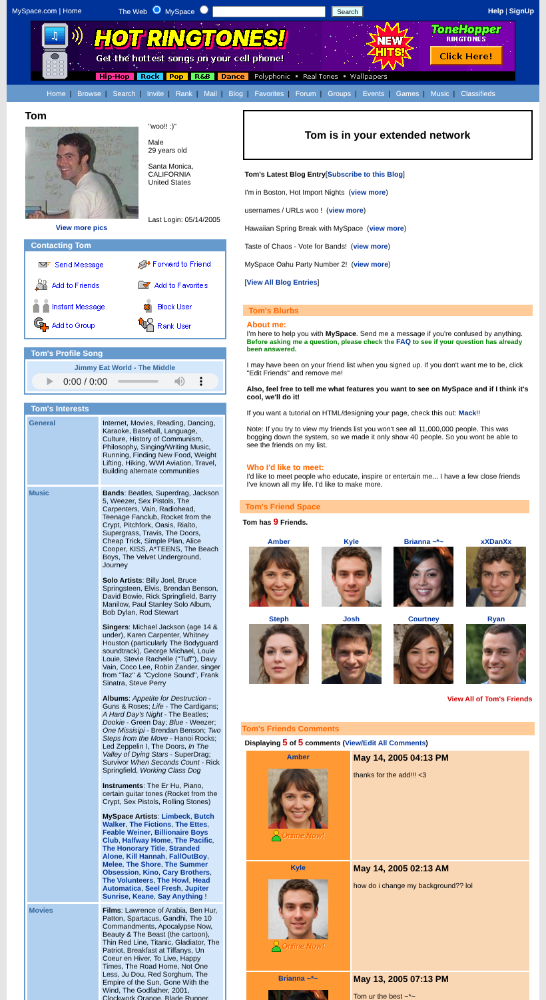
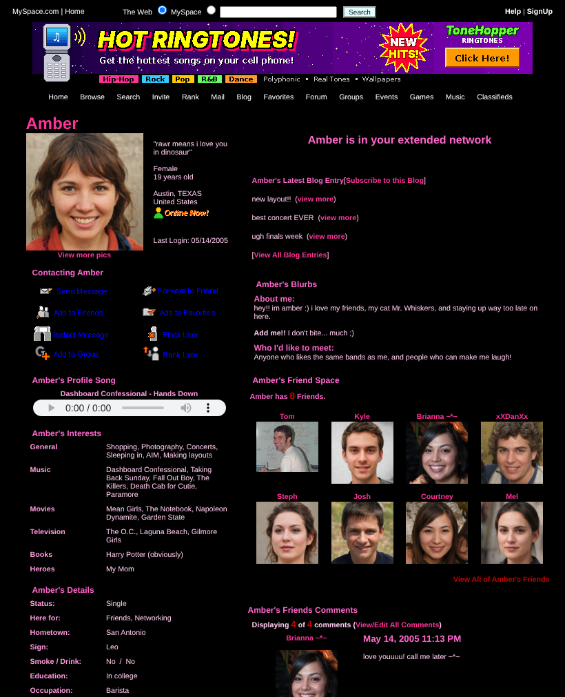
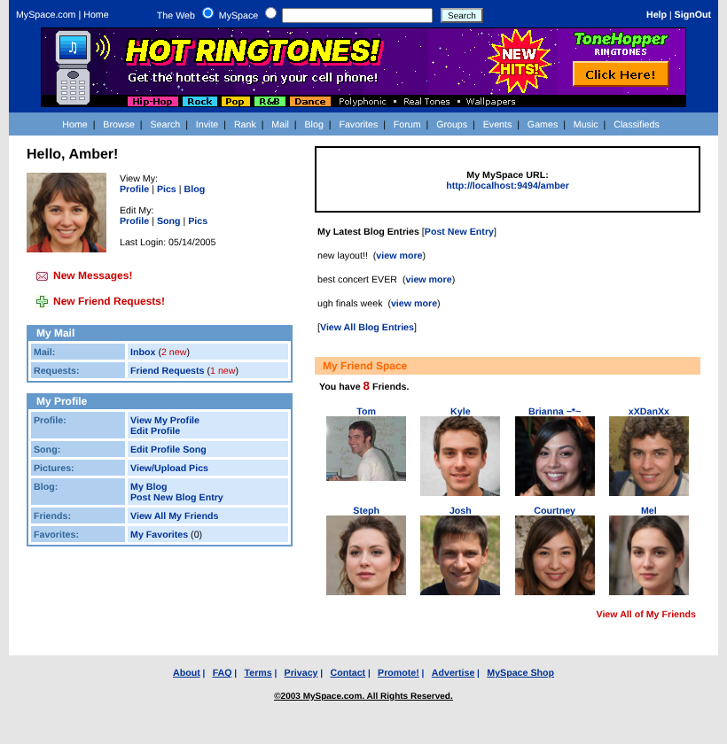
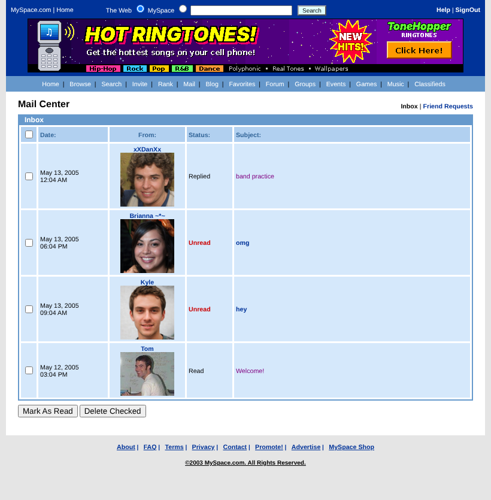
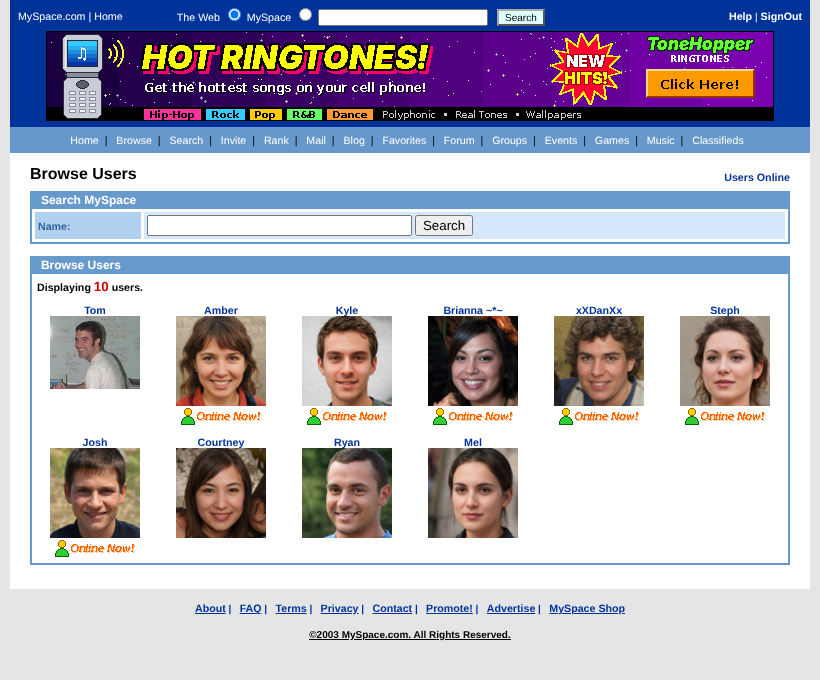

# CRUDSpace
2005 Myspace recreation with Sinatra and Ruby. 
The recreation is a representation of Myspace how it was originally in the year 2005.
#### It features a lot of the original websites functionality including
* User Signup
* Profiles with the original 2005 sections: Interests, Details, Schools, Companies, Blurbs, Friend Space and Friends Comments
* Profile Comments
* Messages and message notifcation
* Friend requests and friend request notifcations
* Blogs, Favorites and Forward to Friend
* Custom profile URLs (e.g. /tom)
* Custom CSS for user profiles (Old myspace layout site codes work here too!)
* Profile pictures and user photo albums

## Screenshots
The homepage and profile are rebuilt from archived 2005 captures of myspace.com, using the original stylesheets.
Screenshots use demo data: apart from Tom, the users are fictional, with AI-generated faces from
[thispersondoesnotexist.com](https://thispersondoesnotexist.com). The advertisers are made up, and
the profile songs are just titles, with no audio uploaded.

#### Homepage


#### Profile


#### Custom profile layout
Profiles accept old MySpace layout codes in Edit Profile.



#### Home


#### Mail


#### Browse



## Setup

These are the steps to get the app up and running:

###  Step 1. Clone this repository
Make a local copy of this project and move into the directory. This project requires Ruby and RubyGems. If you don't have Ruby installed yet, you can find [installation instructions here](https://www.ruby-lang.org/en/).
```
  $ git clone git@github.com:Libaration/CRUDspace.git
  $ cd CRUDspace
```

### Step 2. Create and seed the database
(Do not skip seeding!)
```
  $ rake db:migrate
  $ rake db:seed
```  
This will seed "Tom" into the database with his profile from the archived May 2005 capture of
myspace.com/tom, and his profile picture being the one located at /app/public/images/tom2005.jpg.
The seed is safe to run again on an existing database.<br>
It's important Tom is seeded because he will send a default greeting and friend request
to every user who signs up. To change the greeting or user who does the greeting
Find the #tomswelcome helper method in users_controller.rb

### Step 3. Run the server
```
  $ bundle exec rackup
```
